# J-MaVe Booking — user guide

One short section per role. Screenshots come from **staging** and use invented data only. To refresh them, see "Screenshots" at the end.

**Signing in.** Open the app and sign in with the email and temporary password your administrator gave you. The first time, you must choose a new password (at least 12 characters). After 10 wrong attempts in a minute, the login waits a minute. If your account is deactivated, you cannot sign in: ask an administrator.

**Times and money.** All times are Manila time. All amounts are in pesos (₱).

---

## Super Admin

You set the system up and own the prices, users and settings.

- **First run.** Open `/setup` once, with the setup token from Railway Variables, to create your account. After that, `/setup` no longer exists.
- **Users** (Administration → Users). Click **New user**, choose the role, and give the person the temporary password shown once. Use the **⋯** menu on a row to edit, reset the password (signs them out) or deactivate. You cannot deactivate yourself or the last Super Admin.
  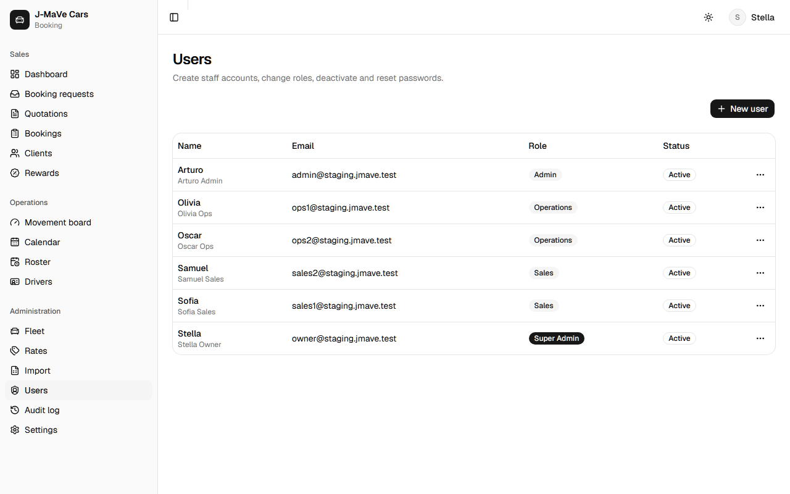
- **Rates** (Administration → Rates). The active rate card prices every new quotation. To change prices:
  1. Click **New draft** to copy the active card, then edit the draft.
  2. Click **Activate**. The old card is archived.

  Issued quotations keep their old prices. Use **Compare** to see the differences between cards, and **Playground** to try prices before you activate.
  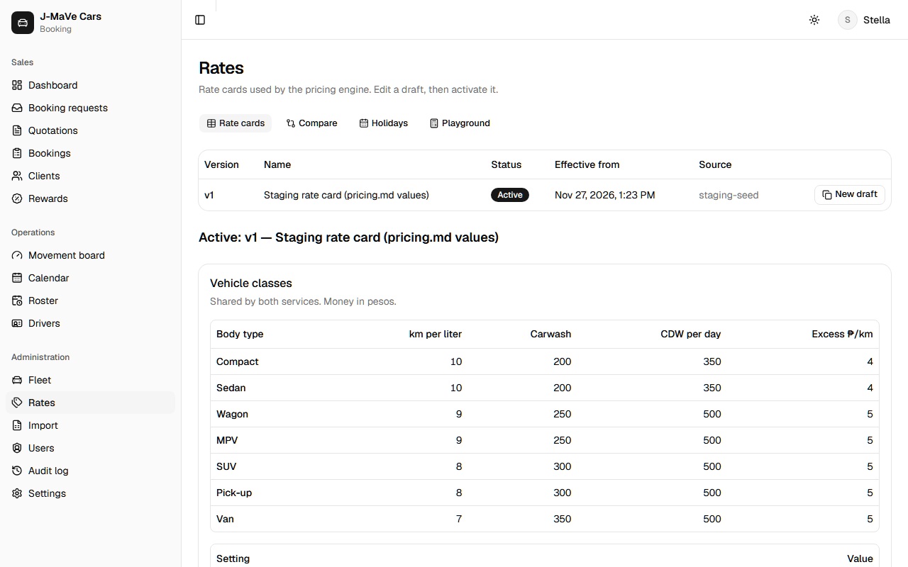
- **Settings.** Business details, fuel prices, quotation validity, turnaround buffer, late-return grace, and the Rework integration (with **Send test lead**).
  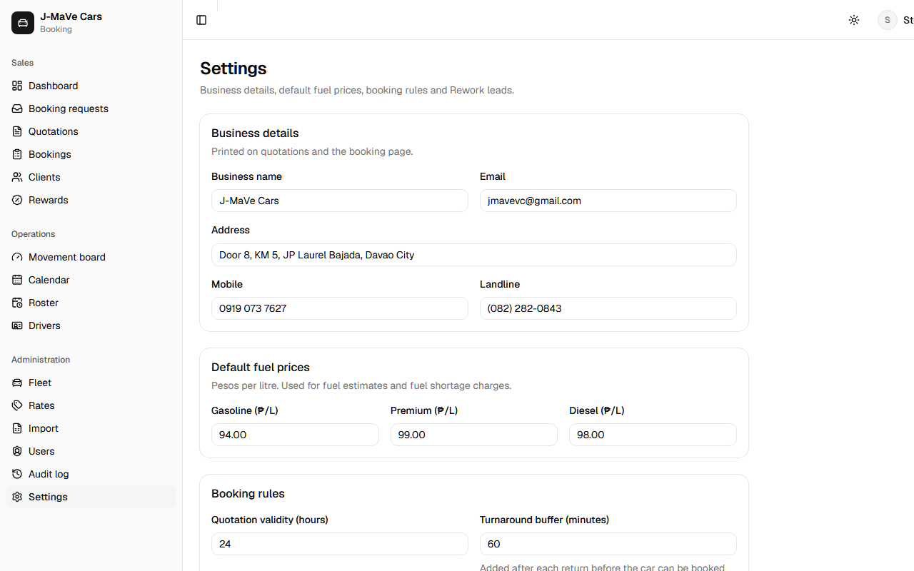
- **Import.** Upload the old `.xlsx` workbooks (up to 40 MB), check the preview, then **Commit**. Running the same file again changes nothing.
  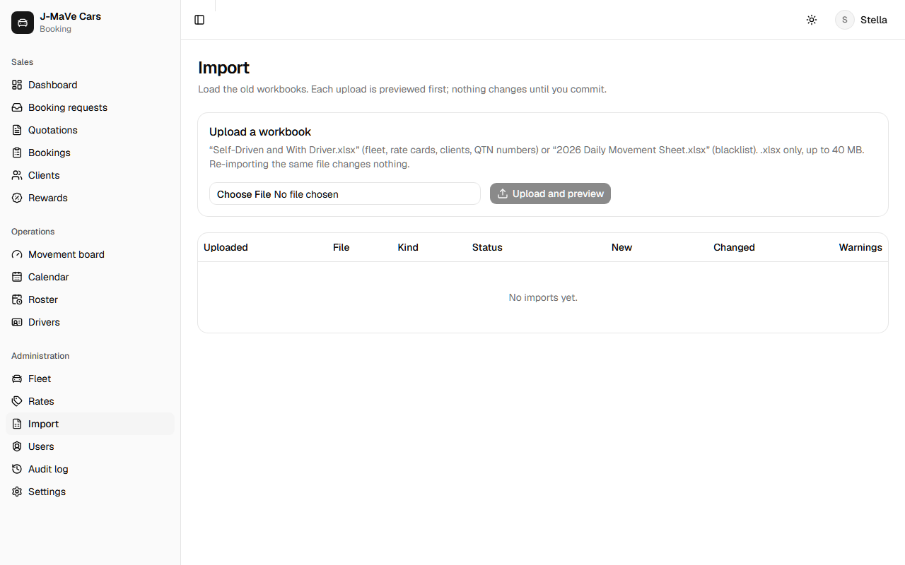
- **Fleet, holidays, loyalty tiers.** You edit these. Admins can only view them.

## Admin

You run the team day to day. You can see prices and settings, but not change them.

- **Users.** Create, edit, reset passwords and deactivate **Sales** and **Operations** users. Super Admin and Admin accounts are managed by the Super Admin only.
- **Audit log** (Administration → Audit log). Every change to prices, bookings, payments, users and settings, newest first.
  - Filter by person (or *System / public page*), record type, action (type the start, for example `payment.` or `booking.`), record id and dates.
  - Click **View** to see one change field by field: **Before → after** shows what was added, removed or changed. **All changes to this record** shows the record's full history.
  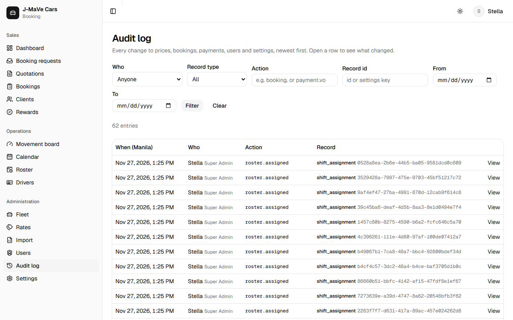
  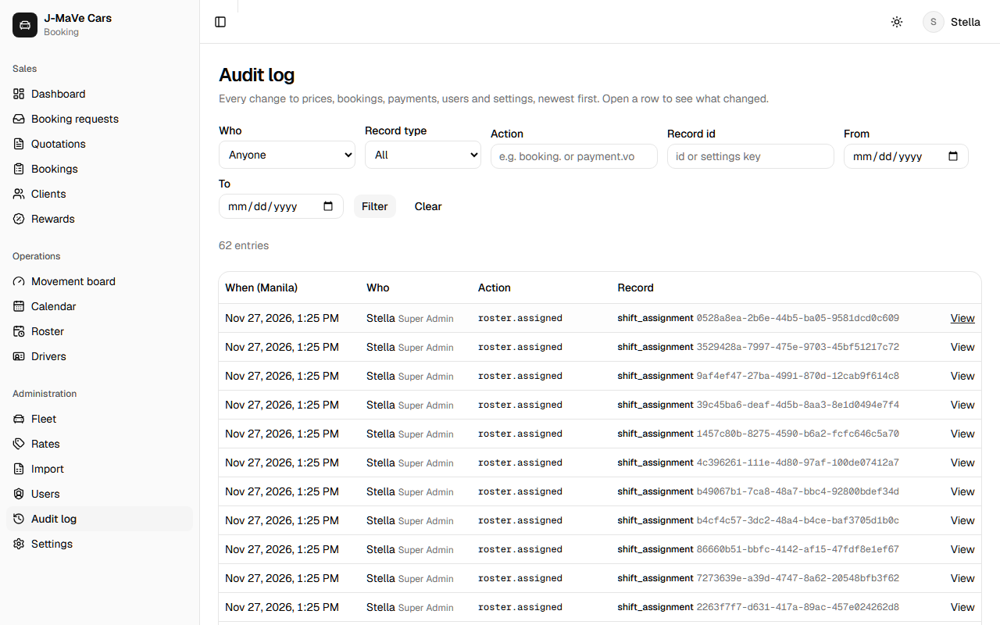
- **Extra powers over Sales:**
  - void payments;
  - confirm without a reservation fee (with a reason);
  - assign a driver who is already busy (with a reason);
  - remove a check-in charge (with a reason);
  - undo a return;
  - blacklist clients;
  - adjust reward points.

## Sales

You quote, book and take payments.

- **Dashboard.** Quotations expiring soon, your quotations today, and who is on duty.
  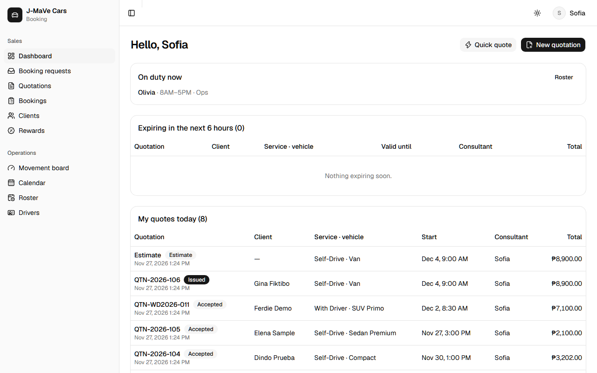
- **Quick quote** (Quotations → Quick quote). A fast estimate with no number. Use **Copy text** for chat, or **Download PDF**. **Make formal** turns it into a numbered quotation.
  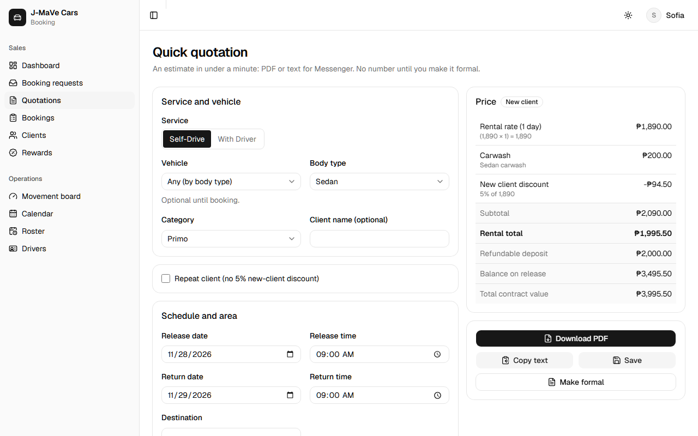
- **Formal quotation** (Quotations → New quotation):
  - Pick or add the client, then choose the car and dates. The availability note shows whether the car is free.
  - Prices update as you type. The draft saves itself.
  - Click **Issue quotation** to give it its `QTN-…` number, a share link and a PDF. **Send by email** sends the PDF to the client.
  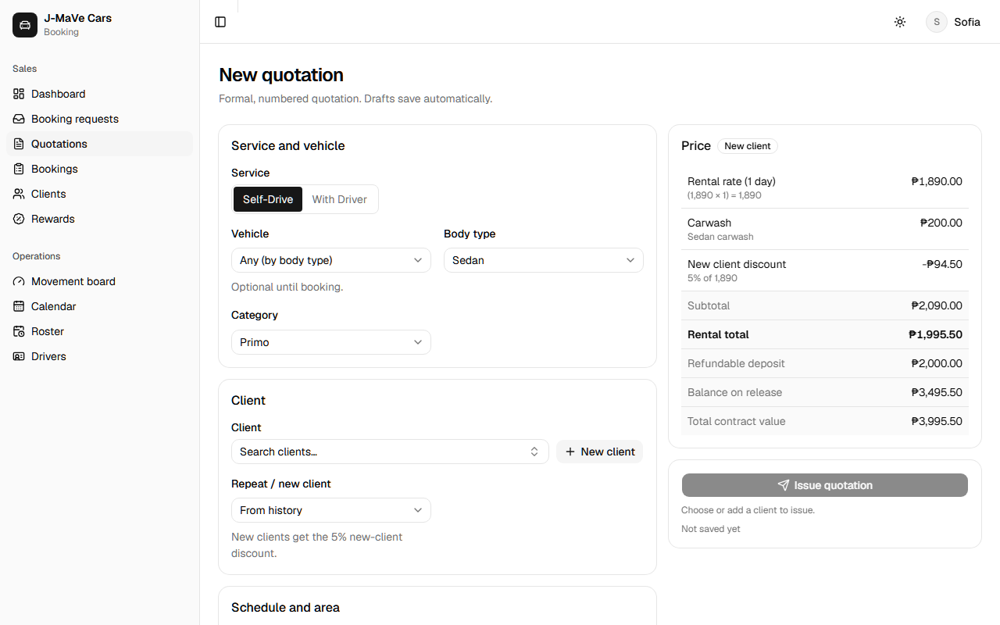
  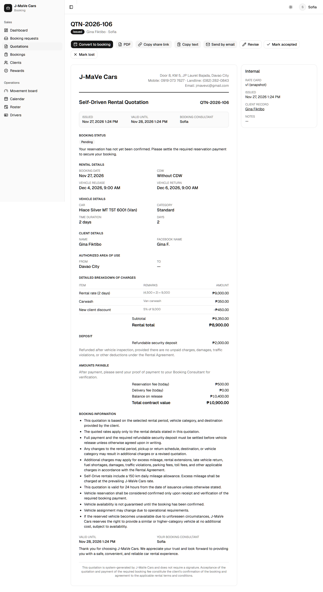
- **Booking.** On an issued quotation, click **Convert to booking**. Then:
  1. Click **Add payment** to record the reservation fee.
  2. Click **Confirm**. The car is now held; a second booking for the same car and time is refused and names the first one.

  Charges, payments, balance and deposit are on the booking page. You can also extend a booking or add a manual charge there.
  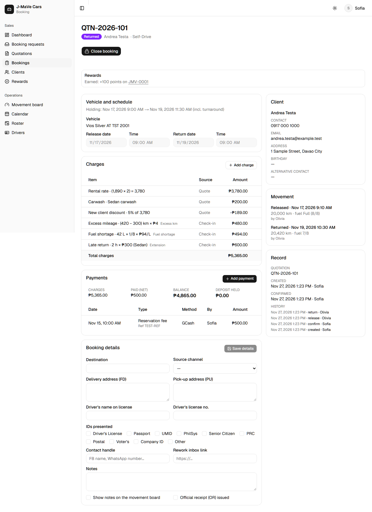
- **Calendar.** Every car by week or month. Pending reservations are striped. Click an empty day to start a quotation for that car.
  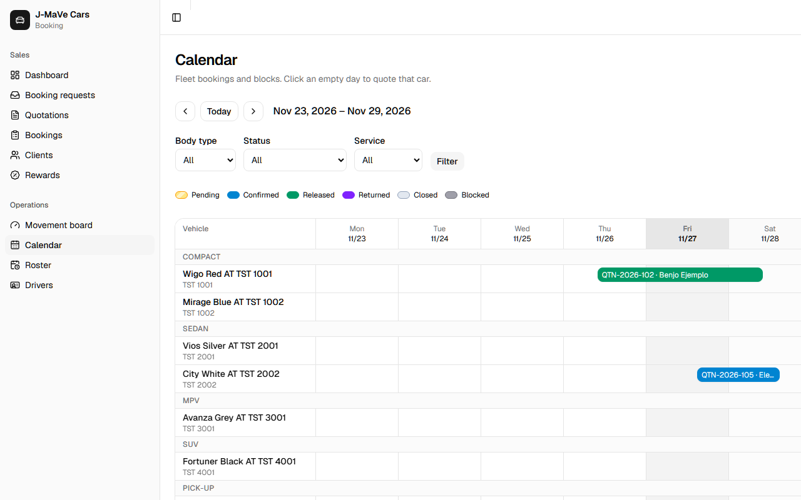
- **Booking requests.** Requests from the public booking page, each with a draft quotation already filled in. Review it, issue it, or **Reject** it with a reason.
  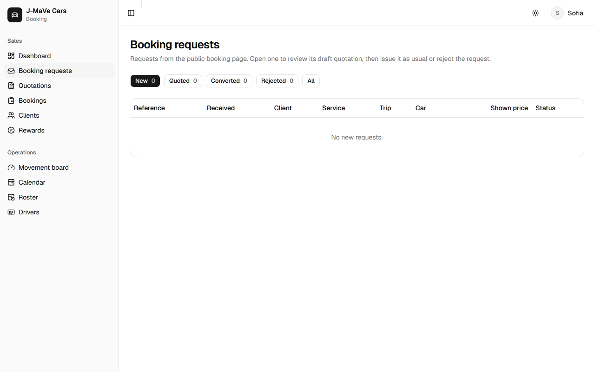
- **Clients and Rewards.** Search by name, FB name, phone or email. A client's page shows their rental history and rewards card (50 points per rental day, 50 points = ₱1). You can redeem points on a formal quotation.
  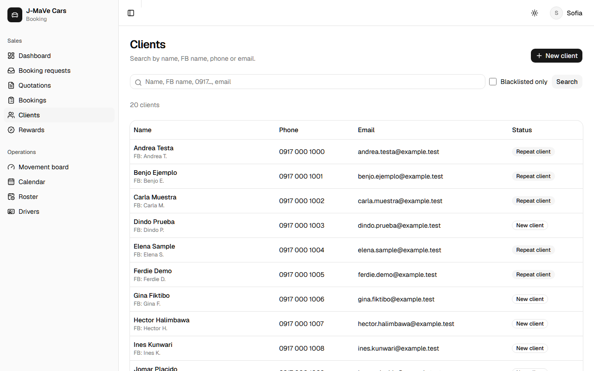
  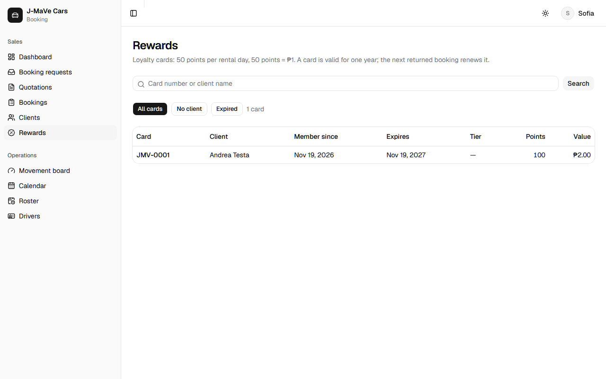

## Operations

You release and receive the cars. The app is built for a phone.

- **Movement board** (your home page). Today's fleet: Return, Out today, Rented, Blocked, Pending reservation and Available.
  - The board also shows the movement timeline, With Driver trips, special instructions, who is on duty, and a 5-day look-ahead.
  - It refreshes every minute.
  - **Print / PDF** prints up to 7 days.
  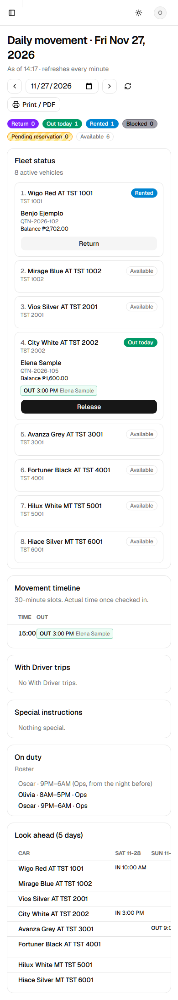
- **Release.** Tap **Release** on the car and enter the actual time, odometer and fuel (eighths). Add notes, for example scratches.
- **Return.** Tap **Return** and enter the same details. The page shows the extra charges before you save: excess km, missing fuel and late return. Times cannot be more than 15 minutes in the future.
- **Roster and Calendar.** View only. Admins edit the roster.
  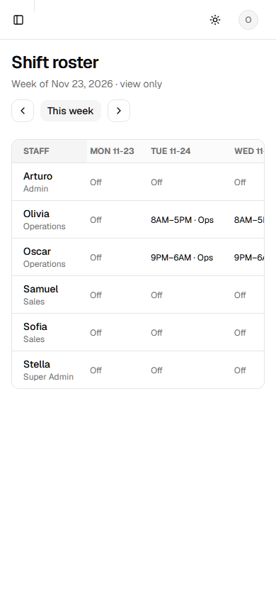

## Public booking page

Clients use this page on the company website, at `book.` or embedded in the main site. No login is needed.

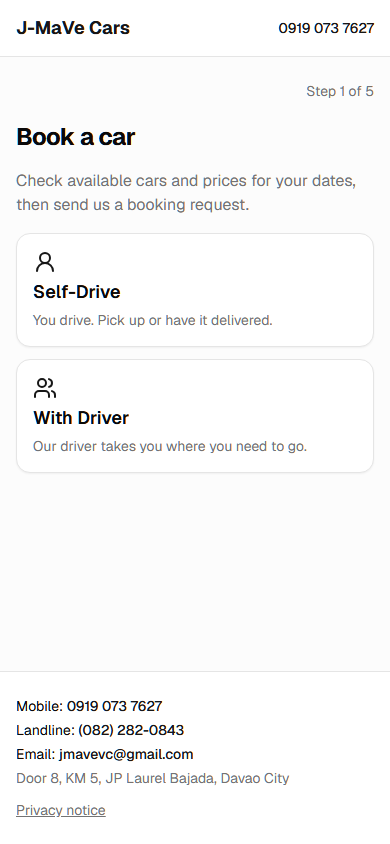

1. The client chooses Self-Drive or With Driver, then the dates.
2. They see the available cars **with prices**.
3. They fill in their details and agree to the privacy notice.
4. They get a `REQ-…` reference.

Each request appears under **Booking requests** with a draft quotation, and is sent to Rework as a lead. **Nothing holds a car until Sales confirms a booking.**

---

### Screenshots

Refresh the screenshots from staging. Use the staging `SEED_PASSWORD` from Railway; never commit it.

```sh
GUIDE_BASE_URL=https://jmave-booking-20-staging-124dd0c5.up.railway.app GUIDE_PASSWORD=<staging SEED_PASSWORD> \
  pnpm exec playwright test -c playwright.guide.config.ts
```
